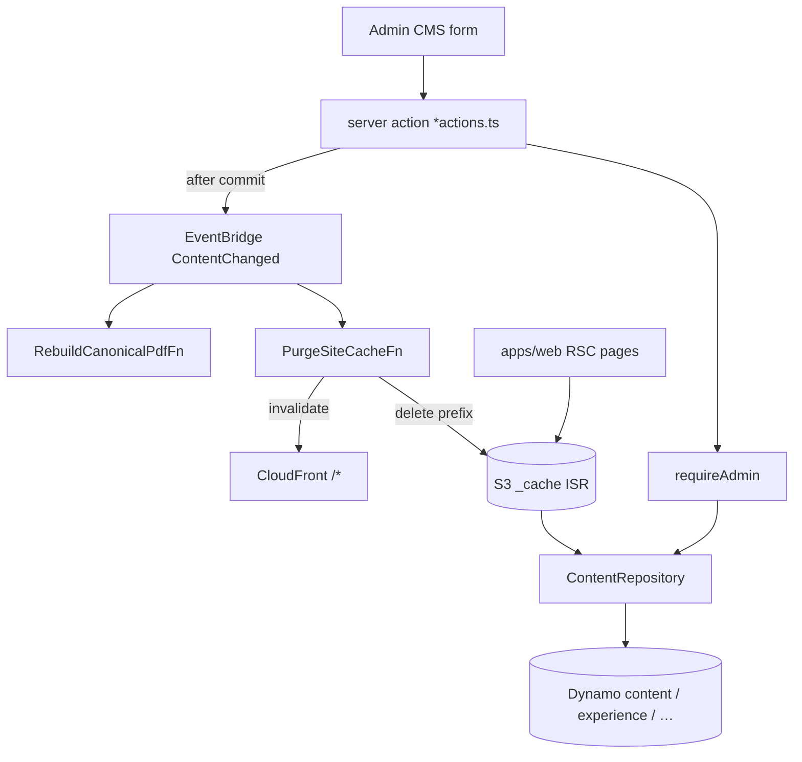

# Flow — CMS save to public site

Admin writes Dynamo via ports, then publishes `ContentChanged`. The web stack
purges the ISR cache + CloudFront on demand (ADR 0008). The 48h page
`revalidate` remains the backstop.

## Diagram

## Modules

| Step        | File                                                                            |
| ----------- | ------------------------------------------------------------------------------- |
| Guardrail   | `apps/admin/src/lib/authorization-guardrail.test.ts`                            |
| Actions     | `apps/admin/src/lib/actions.ts`, `media-actions.ts`                             |
| Publish     | `apps/admin/src/lib/content-publish.ts`, `packages/data/src/content-publish.ts` |
| Purge       | `apps/web/src/lambda/purge-site-cache`, `packages/data/src/site-cache.ts`       |
| Adapter     | `packages/data/src/adapters/multi-table-content-repository.ts`                  |
| Schemas     | `packages/shared/src/schemas/`                                                  |
| Public read | `apps/web` pages + `getContentRepository()`                                     |

## Debug these files

1. Save 401 — [admin-auth.md](admin-auth.md).
2. Conflict toast — `ContentConflictError` / revision.
3. Public page stale after a save — admin `portfolio-admin` warn
   `content change publish failed`, then `portfolio-web-purge-site-cache`
   errors (S3 delete / CloudFront). Worst case it heals on the 48h `revalidate`.
4. Parse errors after deploy — Dynamo omitted nulls vs Zod `.nullable()`
   (same class as job preferences).

## Logs

Admin **`SiteServerFn`** for saves (`portfolio-admin`). Web **`SiteServerFn`**
for render errors (`portfolio-web`). Purge **`PurgeSiteCacheFn`**
(`portfolio-web-purge-site-cache`, logs each purge at INFO).
